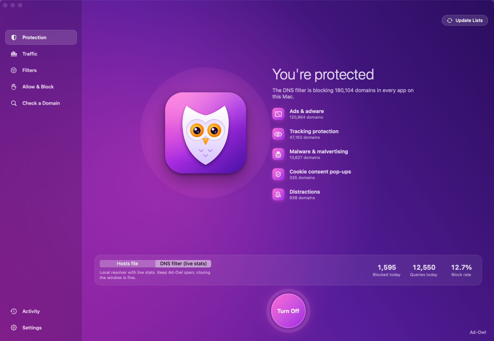
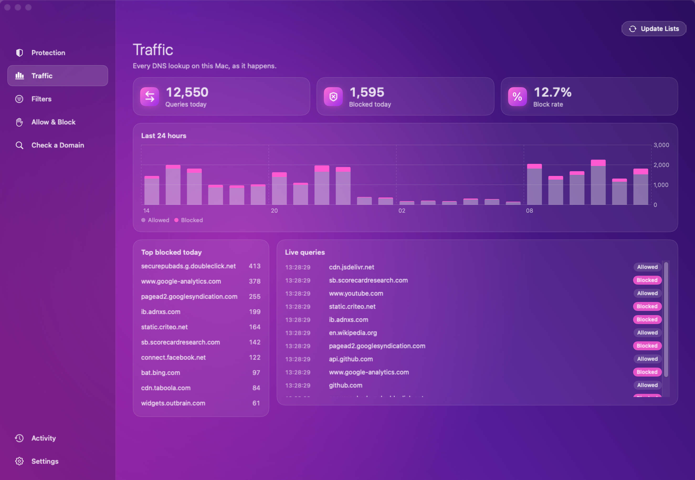
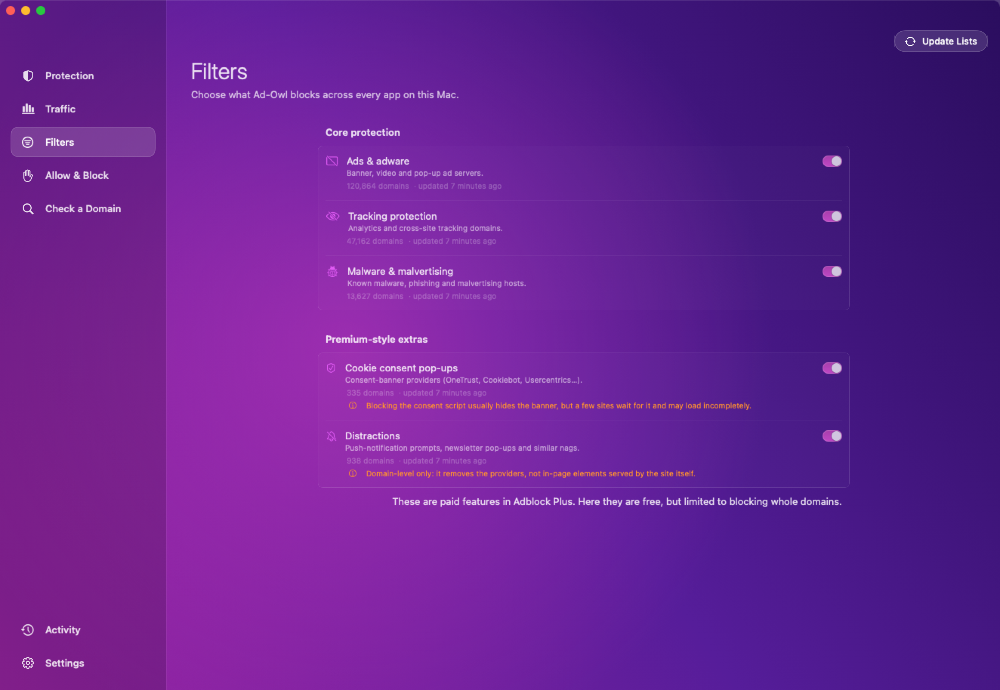

<p align="center"></p>

<h1 align="center">Ad-Owl</h1>

<p align="center">A native macOS ad, tracker and malware blocker that protects every app on your Mac,<br>
with a dashboard, live traffic stats and a menu-bar owl. Free, open source, no browser extension.</p>

<p align="center"></p>

## Features

- **System-wide blocking.** Works for every app (browsers, mail, games, background apps), not just one browser.
- **Five filter sets.** Ads & adware, tracking protection, malware & malvertising, plus the extras Adblock Plus
  sells as Premium: cookie-consent pop-ups and distractions (push and newsletter prompts). About 180,000 domains in all.
- **Two blocking methods.** Write the block into `/etc/hosts` once, or run a local DNS filter with live statistics.
- **Live traffic.** Queries and blocks per hour, top blocked domains, and a live feed of every lookup (DNS filter mode).
- **Allow & block lists.** Never block a site that breaks; always block extra domains.
- **Check a domain.** Shows which lists contain a domain and what macOS resolves it to right now.
- **Menu-bar owl.** Its eyes are open while blocking is on and closed while it's off; turn blocking on or off from the menu.
- **Safe admin access.** The app runs unprivileged and asks for your password through the standard macOS prompt
  only when it changes system settings.

<p align="center">
  
  
</p>

<sub>Screenshots use sample data.</sub>

## Requirements

- macOS 14 Sonoma or later
- Xcode or the Swift 6 toolchain to build

## Build and run

```bash
git clone https://github.com/rudiairobot/ad-owl.git
cd ad-owl
./scripts/build-app.sh      # produces build/Ad-Owl.app (ad-hoc signed)
open build/Ad-Owl.app
```

Move `build/Ad-Owl.app` to `/Applications` if you want to keep it. On first launch, press **Update Lists**,
then the round **Turn On** button. macOS asks for your password once.

The app is ad-hoc signed, not notarized. If you download a build made on another Mac, macOS may block it:
right-click the app and choose **Open**.

### Development

```bash
swift test                                        # unit tests
HOSTSHIELD_LIVE=1 swift test --filter LiveTests   # also downloads the real lists
./scripts/make-icon.sh                            # redraw the app icon
./scripts/screenshots.sh                          # regenerate the README screenshots from sample data
```

## What it maps from Adblock Plus

| Adblock Plus | Ad-Owl |
|---|---|
| Ad blocking (free) | **Ads & adware** (StevenBlack, Peter Lowe, EasyList domain rules) |
| Tracking protection (free) | **Tracking protection** (EasyPrivacy domain rules) |
| Malware protection | **Malware & malvertising** (URLhaus, Dandelion Sprout) |
| Premium: block cookie consent pop-ups | **Cookie consent pop-ups** (Fanboy Cookiemonster + built-in CMP domains) |
| Premium: block distractions | **Distractions** (Fanboy Annoyances + built-in push/newsletter providers) |
| Premium: "keep your blocker on" | Dashboard detects when the block is removed and offers one-click restore |
| Premium: VPN | Not included |
| Premium: ads in iOS apps | Not applicable (macOS app) |

## Two blocking methods

| | Hosts file | DNS filter |
|---|---|---|
| How | Edits `/etc/hosts` once | Runs a local resolver on this Mac and points DNS at it |
| Live statistics, query log, top blocked | No | Yes |
| Blocks subdomains of a listed domain | No (exact names) | Yes |
| Filter changes take effect | After re-applying (password) | Instantly |
| Needs Ad-Owl running | No | Yes (window can be closed; quitting turns it off) |

DNS filter details:
- The resolver listens on port 53 (macOS lets unprivileged apps bind it), answers only
  queries from this Mac, blocks with `0.0.0.0` / `::`, and forwards everything else to
  your existing DNS servers (detected automatically, so corporate and DHCP DNS keep working).
  VPN split-DNS resolvers are scoped by domain and are not touched.
- Turning it on sets DNS on your Wi-Fi/Ethernet services to `127.0.0.1` (plus your original
  servers as a backup entry, see Settings) in one password prompt. Your previous settings are
  saved and restored when you turn blocking off or quit.
- **If Ad-Owl is force-quit or crashes while the DNS filter is on**, macOS keeps pointing at
  it. With the backup entry enabled (default) lookups fall back to your original servers; if you
  disabled it, open Ad-Owl and choose Turn Off, or run
  `networksetup -setdnsservers Wi-Fi Empty` in Terminal.

## Limits

- Whole exact host names only: no wildcards, no page-element hiding, no ads served
  from the same domain as the content (e.g. YouTube).
- Hosts-file mode can't count blocked requests, because blocked lookups never reach any logger.
  Use the DNS filter for statistics.
- Apps using their own encrypted DNS (DNS-over-HTTPS in a browser, some VPNs) bypass both methods.
- Very large hosts files add a little lookup time. The default set is about 180k domains;
  turn off a list in Filters if you notice slowdowns.
- Cookie-consent blocking can leave a few sites half-loaded. Add them to *Never block*.

## How admin access works

The app runs unprivileged. When you apply or turn off blocking it writes the new
hosts file to a private staging folder and asks macOS (the standard password
prompt) to install it. Only the block between the `HostShield begin/end` markers
is ever touched, only validated host names are written, and a copy of your original
is kept at `/etc/hosts.hostshield-backup`. List providers' own hosts are never blocked,
so updates keep working.

State lives in `~/Library/Application Support/HostShield`.
`HOSTSHIELD_HOSTS` and `HOSTSHIELD_HOME` override the hosts path and data folder (used for testing).
`HOSTSHIELD_DNS_PORT` (resolver port, default 53) and `HOSTSHIELD_SKIP_NETWORK=1` (never touch network settings) exist for development.

## Credits and license

Ad-Owl downloads its filter lists at runtime from their maintainers; they are not bundled with the app and keep
their own licenses: [StevenBlack hosts](https://github.com/StevenBlack/hosts),
[Peter Lowe's list](https://pgl.yoyo.org/adservers/), [EasyList and EasyPrivacy](https://easylist.to),
[URLhaus](https://urlhaus.abuse.ch) via [malware-filter](https://gitlab.com/malware-filter),
[Dandelion Sprout's anti-malware list](https://github.com/DandelionSprout/adfilt) and
[Fanboy's lists](https://www.fanboy.co.nz). Thanks to all of them.

Ad-Owl is not affiliated with Adblock Plus or eyeo GmbH; Adblock Plus is mentioned only to compare features.

Released under the [MIT License](LICENSE).
